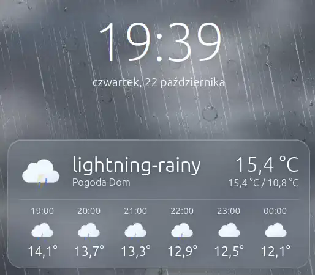

# Weather Scene Card

<p align="center">
  
</p>

Karta Lovelace dla Home Assistant: zegar i prognoza pogody na tle animowanej
sceny WebGL. Scena odwzorowuje aktualne warunki: krople deszczu na szybie,
śnieg, mgłę, burzę z błyskawicami, a także słońce, księżyc i gwiazdy zależnie
od pory dnia i wysokości słońca. Ikony to animowane [Meteocons](https://github.com/basmilius/weather-icons).

Karta jest napisana w Lit i three.js i budowana do jednego pliku
`weather-scene-card.js`, bez zewnętrznych zależności w czasie działania.

## Wymagania

- Home Assistant 2024.3 lub nowszy (prognozy pobierane przez subskrypcję
  `weather/subscribe_forecast`).
- Encja pogodowa (`weather.*`) z prognozą godzinową i/lub dzienną, np.
  `weather.forecast_home` z integracji Met.no.
- Przeglądarka z obsługą WebGL (każda współczesna przeglądarka i aplikacja
  Home Assistant Companion).
- Do zbudowania karty: Node.js 20 lub nowszy i npm.

## Instalacja

### 1. Zbuduj plik karty

```bash
git clone https://github.com/jarekmor/HA_Weather_Card.git
cd HA_Weather_Card
npm ci
npm run build
```

Wynik: `dist/weather-scene-card.js`.

### 2. Skopiuj plik do Home Assistant

Umieść plik w katalogu `www` w konfiguracji HA (jeśli katalog nie istnieje,
utwórz go i zrestartuj Home Assistant). Pliki z `/config/www/` są dostępne pod
adresem `/local/`.

Przykłady:

```bash
# HA OS / Supervised (dodatek Samba lub SSH)
scp dist/weather-scene-card.js root@homeassistant.local:/config/www/

# HA w Dockerze (kontener o nazwie "homeassistant")
docker cp dist/weather-scene-card.js homeassistant:/config/www/
```

### 3. Dodaj zasób (resource) w Lovelace

**Z interfejsu:**

1. Włącz *Tryb zaawansowany* w swoim profilu użytkownika.
2. Przejdź do **Ustawienia → Pulpity nawigacyjne → ⋮ (menu w prawym górnym
   rogu) → Zasoby**.
3. Kliknij **Dodaj zasób** i wpisz:
   - URL: `/local/weather-scene-card.js?v=0.1.1`
   - Typ zasobu: **Moduł JavaScript**
4. Odśwież stronę w przeglądarce (najlepiej z wyczyszczeniem cache:
   Ctrl+Shift+R).

**W trybie YAML** (`configuration.yaml`):

```yaml
lovelace:
  resources:
    - url: /local/weather-scene-card.js?v=0.1.1
      type: module
```

> Parametr `?v=` służy do omijania cache przeglądarki. Po każdej aktualizacji
> pliku zmień jego wartość (np. na nowy numer wersji), inaczej przeglądarki
> i aplikacja mobilna mogą dalej używać starej wersji.

### 4. Dodaj kartę do pulpitu

Edytuj pulpit, kliknij **Dodaj kartę** i wyszukaj **Weather Scene Card**.
Karta ma edytor wizualny. Możesz też wkleić konfigurację YAML:

```yaml
type: custom:weather-scene-card
entity: weather.forecast_home
```

## Konfiguracja

| Opcja                | Typ     | Domyślnie                 | Opis                                                                 |
| -------------------- | ------- | ------------------------- | -------------------------------------------------------------------- |
| `entity`             | string  | **wymagana**              | Encja pogodowa (`weather.*`).                                        |
| `title`              | string  | brak                      | Tytuł wyświetlany w nagłówku karty.                                  |
| `name`               | string  | nazwa encji               | Tekst pod opisem warunków pogodowych.                                |
| `hourly_count`       | number  | `6`                       | Liczba godzin w prognozie godzinowej (0–12, `0` ukrywa prognozę).    |
| `height`             | string  | `420px`                   | Wysokość sceny (dowolna wartość CSS).                                |
| `quality`            | string  | `high`                    | Jakość animacji: `high`, `medium` lub `low`.                         |
| `show_clock`         | boolean | `true`                    | Pokazuje zegar.                                                      |
| `condition_override` | string  | brak                      | Wymusza wyświetlane warunki (do testów), np. `rainy`, `snowy`.       |

Dostępne wartości `condition_override`: `sunny`, `clear-night`,
`partlycloudy`, `cloudy`, `fog`, `rainy`, `pouring`, `lightning`,
`lightning-rainy`, `snowy`, `snowy-rainy`, `hail`, `windy`, `windy-variant`,
`exceptional`.

Przykład pełnej konfiguracji:

```yaml
type: custom:weather-scene-card
entity: weather.forecast_home
title: Pogoda
name: Dom
hourly_count: 8
height: 480px
quality: medium
show_clock: true
```

Język, format daty, godziny i jednostki są brane z profilu użytkownika
w Home Assistant.

## Wydajność

Karta jest przygotowana do pracy na tabletach ściennych:

- animacja zatrzymuje się, gdy karta jest poza ekranem lub karta przeglądarki
  jest ukryta;
- kontekst WebGL jest zwalniany 30 s po opuszczeniu widoku;
- przy ustawieniu systemowym „ogranicz ruch” (`prefers-reduced-motion`)
  animacja działa w zredukowanym trybie.

Na słabszych urządzeniach ustaw `quality: medium` lub `quality: low`.

## Aktualizacja

1. Pobierz zmiany (`git pull`) i zbuduj ponownie (`npm run build`).
2. Skopiuj nowy `dist/weather-scene-card.js` do `/config/www/`.
3. Zmień parametr `?v=` w adresie zasobu i odśwież przeglądarkę.

## Rozwiązywanie problemów

- **„Custom element doesn't exist: weather-scene-card”**: zasób nie został
  załadowany. Sprawdź URL i typ zasobu (*Moduł JavaScript*) i wyczyść cache
  przeglądarki. W konsoli przeglądarki (F12) po poprawnym załadowaniu
  pojawia się wpis `WEATHER-SCENE-CARD 0.1.1`.
- **„Entity not found”**: sprawdź identyfikator encji w
  **Narzędzia deweloperskie → Stany**.
- **Brak prognozy**: integracja pogodowa musi udostępniać prognozę godzinową
  lub dzienną (usługa `weather.get_forecasts`).
- **Stara wersja po aktualizacji**: zmień `?v=` w adresie zasobu; w aplikacji
  Companion wyczyść pamięć podręczną (Ustawienia aplikacji → Debugowanie /
  Resetuj frontend cache).

## Rozwój

```bash
npm run dev     # podgląd z symulowanym hass: http://127.0.0.1:5179
npm run build   # → dist/weather-scene-card.js
```

Parametry podglądu w adresie URL: `c` – warunki pogodowe, `e` – wysokość słońca
w stopniach, `q` – jakość, np. `http://127.0.0.1:5179/?c=rainy&e=-15&q=high`.

## Licencja

ISC. Ikony Meteocons © Bas Milius, licencja MIT.
